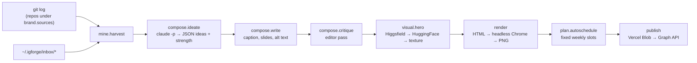

# igforge

Instagram posts generated from what you actually built. igforge reads the commit
history of your repositories and a folder of quick notes, proposes post ideas,
writes them, runs an editor pass, renders the slides as PNGs, puts them on a
calendar and — if you configure it — publishes them through the Instagram Graph API.

Python 3.11+, standard library only. No API key to manage: text is written by
`claude -p` (headless [Claude Code](https://docs.anthropic.com/en/docs/claude-code)),
using whatever login Claude Code already has on the machine.

## Why

Build-in-public only works if it starts from facts, and the facts are already in
`git log`. The hard part is not having something to say, it is turning a week of
commits into a post without inventing anything. igforge makes the commit log the
only source material and adds an explicit editor pass whose job is to cut jargon,
generic lines and — above all — numbers that do not appear in the commits.

## Pipeline



| Stage | Implementation | If unavailable |
|---|---|---|
| Raw material | `git log --since=N.days.ago --no-merges --shortstat` on every repo found under the configured roots | — |
| Ideas, copy, editor | `claude -p` with all tools disallowed, run in an empty temp dir | the command fails, nothing is half-written |
| Cover image | `claude -p` driving the Higgsfield or HuggingFace MCP server, else a procedural SVG texture | the texture never fails |
| Slides | HTML templates rendered by headless Chrome/Chromium at 1080×1350 (1080×1920 for reels) | needs a Chromium |
| Publishing | Vercel Blob for public URLs + Instagram Graph API | stays a dry run |

### Mining

`mine._git_repos` walks each root to depth 2, skipping heavy trees (`node_modules`,
`Library`, `build`, dot-dirs, …) and never descending into a repo once found. Each
`git log` record is framed with ASCII separators — `\x1e` starts a record, `\x1f`
separates fields — so the `--shortstat` line that git prints after the body lands in
the last field of the right commit. Merge, WIP, typo and version-bump commits are
dropped. At most 200 commits are kept, 90 are shown to the model.

### Talking to the model

`brain.ask_json` requires a JSON reply. Models wrap JSON in prose or fences, so
`_extract_json` tries, in order: the whole text, a fenced block, then the first
balanced `{…}` or `[…]` (tracking string literals and escapes, and choosing
whichever bracket opens first so an array of objects is not mistaken for its first
element). If all fail, the bad reply is sent back with a request to retry, up to
two times.

### Scheduling

Slots are fixed: Tuesday 19:30, Thursday 19:30, Saturday 11:00 (`plan.DEFAULT_SLOTS`).
Let $T = (t_1 < t_2 < \dots)$ be the slot instants after now that are not already
taken by a scheduled post, and let the new posts be sorted by the strength
$s \in [1, 10]$ the model assigned during ideation, $s_{(1)} \ge s_{(2)} \ge \dots$.
Assignment is greedy:

$$
\operatorname{slot}\!\left(p_{(k)}\right) = t_k
$$

so the strongest idea always goes out first and nothing collides with what is
already on the calendar. `igforge schedule <id> <when>` overrides it by hand
(`2026-08-12 19:30`, `12/08` as day/month, `today`, `tomorrow`; a date without a
time defaults to 19:30).

### Rendering

Each slide is a standalone HTML page using the brand palette and fonts, screenshot
by headless Chrome. Title size is a step function of length — the first step whose
character limit fits the text wins — so long titles shrink instead of overflowing.
All text is HTML-escaped (covered by tests). A carousel has at most 10 slides.

## Usage

```sh
igforge auto                        # ideas → copy → slides → calendar, unattended
igforge auto -n 5 --days 30         # five posts, looking at the last month
igforge ideas -n 8                  # ideas only, you pick
igforge new "why I chose this ADC" --format carousel
igforge inbox "the footprint mistake would make a good post"
igforge calendar                    # what goes out when
igforge schedule <id> "12/08 19:30"
igforge open <id>                   # open the folder (any unique part of the id)
igforge publish <id>                # dry run: shows what would be published
igforge publish <id> --now
igforge export <id>                 # copy to ~/Desktop/IG-<id>, ready to post by hand
```

Run `igforge --help` for the full list.

## Brand kit

`igforge init` writes `~/.igforge/brand.json`; edit it with `igforge brand --edit`.
It is sent verbatim to the model on every generation and decides most of the output
quality: name and handle, persona, audience, topics, tone, things to never do,
closing lines, hashtags, palette, fonts, visual style for the cover, which
directories to mine, and the content language. A documented example with neutral
placeholder values is in [`brand.example.json`](brand.example.json) (the same values
are the defaults in `igforge/brand.py`).

## Data

Everything lives in `~/.igforge` (override with `IGFORGE_HOME`), all human-readable:

```
~/.igforge/
  brand.json              who you are and how you sound
  config.json             publishing credentials (optional)
  inbox/                  loose notes, read on the next mine
  material/               what was found in the repos, by date
  posts/<id>/
    post.json             the whole post
    POST.md               readable version
    caption.txt           caption + hashtags, ready to paste
    hero.png              cover
    slides/01.png …       slides in publishing order
    preview.png           preview strip
```

## Install

```sh
./scripts/install.sh              # creates ~/bin/igforge pointing at this checkout
./scripts/install.sh --weekly     # + a launchd job: Mondays 08:00, prepares 3 posts
./scripts/uninstall.sh
```

Needs `~/bin` on your `PATH`, Claude Code (`claude`) logged in, and Google Chrome or
another Chromium.

## Publishing for real

Dry run is the default and is fine for posting by hand. Automatic publishing needs
`~/.igforge/config.json` (or the env vars `IG_USER_ID`, `IG_ACCESS_TOKEN`,
`BLOB_READ_WRITE_TOKEN`):

```json
{
  "ig_user_id": "17841…",
  "ig_access_token": "EAA…",
  "blob_token": "vercel_blob_rw_…"
}
```

- `ig_user_id`, `ig_access_token`: an Instagram **Business or Creator** account
  linked to a Facebook Page, and a Meta app with `instagram_content_publish`. Use a
  long-lived token; the short-lived one expires in an hour.
- `blob_token`: the Graph API only accepts public image URLs, so PNGs are uploaded
  to Vercel Blob first.

Carousels are published as child containers, each polled until ready, then a
`CAROUSEL` container and `media_publish`. Reels are not published: igforge only
produces the script and cover, not the video.

## Tests

```sh
python3 -m unittest discover -s tests -t .
```

32 tests on the deterministic parts: ids and slugs, repo discovery, git-log
parsing, JSON extraction from model output, calendar slots and date parsing, HTML
escaping in slides, caption limits. The model and the network are never called.

## Limitations

- macOS-oriented: image normalisation uses `sips`, the weekly job uses `launchd`
  and `osascript`. The core pipeline is plain Python and should run elsewhere with
  small changes.
- Depends on Claude Code being installed and logged in; cover generation through
  MCP additionally needs those servers configured in Claude Code.
- Prompts are written in English and instruct the model to write in the brand's
  `language`; output in other languages has not been re-verified since the prompts
  were translated.
- Instagram Graph API version is pinned to `v21.0` (configurable in `config.json`).

## License

MIT. See [LICENSE](LICENSE).
